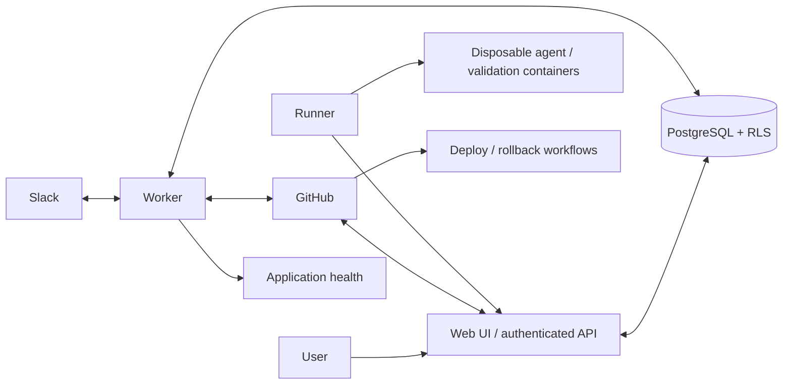

# Architecture and interfaces

## Processes

- **Web:** Next.js UI and JSON/SSE API. GitHub authentication, tenant/role checks, administration, provider webhooks, and runner endpoints.
- **Worker:** durable stage scheduling, GitHub reconciliation, external effects, release health, and Slack Socket Mode. Start one worker in the prototype. Database constraints and leases prevent accidental duplicate claims, but distributed Slack ownership is not implemented.
- **Runner:** tenant-bound outbound supervisor on a Docker host. Only the supervisor sees scoped GitHub tokens or the actual model API credential. A worktree and explicit Codex session stay assigned to one runner across stages.
- **PostgreSQL:** durable source of truth for runs, jobs, events, stage outputs, artifacts, integration secrets, policies, and user questions. GitHub remains authoritative for issues and source code.

## Durable data model

The initial migration includes tenants, memberships, invitations, projects, integrations, runners, work items, runs, jobs, events, stage results, artifacts, questions, profiles, effects, releases, incidents, inbox deliveries, Slack account links/nonces, and notifications. Auth users, expiring session hashes, and OAuth state hashes are global trusted-server records.

All tenant tables enforce `ENABLE` and `FORCE ROW LEVEL SECURITY`. Each scoped transaction calls `set_config('app.tenant_id', ..., true)`; absent context returns no tenant rows. Runtime connections use a non-owner, non-superuser role without BYPASSRLS. Composite foreign keys protect project/run/job/artifact relationships. Narrow security-definer directory functions allow worker tenant enumeration, authenticated account membership lookup, hash-based runner authentication, and accepting GitHub-login invitations. No direct database access is exposed to browsers or runners.

Run status: queued, running, waiting, paused, succeeded, failed, cancelled, rolled_back. Stage: discovery, requirements, design, engineering, testing, merge, deployment, verification. A partial unique index permits only one nonqueued active run per project. Ready issues are ordered by readiness time. Reconciliation does not restart a completed labeled issue; explicit start or a new ready transition can create a new run.

## Adapter contracts

`src/lib/types.ts` exports AgentAdapter, BacklogAdapter, SourceAdapter, DeploymentAdapter, MessagingAdapter, MonitoringAdapter, project/policy schemas, and shared lifecycle types. The first concrete providers are Codex CLI, GitHub, Slack, and HTTP health checks.

Agent execution is cancellable and streams safe progress types, returning a validated result with summary, question, UI relevance, suggestions, and details. The supervisor attaches validation evidence, commit identity, usage, and bounded artifacts. Unsupported provider capabilities must be declared explicitly; a future adapter cannot silently replace a required validation or policy boundary.

The platform executes configured tests itself, then checks GitHub CI against the same head. It never treats an agent’s statement that tests passed as sufficient evidence for a merge.

## JSON API

All endpoints are under `/api`. Browser mutation requests require the configured same-origin header and a valid HTTP-only session cookie. Tenant membership is checked before resources are read. Admin-only credentials are encrypted at rest and never returned from configuration reads.

| Endpoint | Purpose |
| --- | --- |
| `GET /auth/login`, `GET /auth/callback`, `POST /auth/logout` | GitHub OAuth and expiring sessions |
| `GET /me` | Signed-in account and its tenant memberships |
| `GET /tenants/:tenant/dashboard` | Project/run/runner/incident overview |
| `POST /tenants/:tenant/projects`, `PUT .../projects/:id` | Project and versioned policy configuration |
| `GET .../projects/:id/diagnostics` | Verify repository/workflow visibility |
| `PUT .../branding` | Organization identity/theme |
| `GET/PUT .../integrations` | Connections; GET excludes secrets |
| `GET/POST .../members`, `PUT/DELETE .../members/:user` | Invitations and role management |
| `POST .../runners`, `DELETE .../runners/:id` | One-time runner token registration/revocation |
| `POST .../requests` | Create a linked GitHub issue, optionally ready |
| `GET .../runs/:id` | Run, timeline, results, questions, and external effects |
| `POST .../runs/:id/{answer,message,resume,cancel}` | Role-checked execution controls |
| `GET .../events?run=:id` | SSE with event IDs, replay, periodic session/membership recheck |
| `GET .../artifacts/:id` | Tenant-authorized evidence; restrictive content headers |
| `POST .../slack-link` | Consume a tenant/workspace/user-bound single-use nonce |
| `POST /webhooks/github/:tenant` | Signature-validated durable event intake |
| `POST /runner/claim` | Claim one tenant-scoped job using a runner bearer token |
| `POST /runner/:job/{heartbeat,events,token,complete}` | Lease-bound execution protocol |

Request schemas are validated using Zod. API errors return a stable `error` string and, for validation failures, field details. SSE reconnects after bounded streams and honors Last-Event-ID. The initial dashboard/run history is bounded; full archival search and pagination are future work.

## Failures and authority

- **Policy change:** saving project configuration increments its policy version. The next privileged operation or runner heartbeat pauses execution. Resume adopts the current policy; it does not bypass it.
- **Unknown external outcome:** an effect is recorded before dispatch. On restart the worker reads provider state using the PR branch, merge status, or workflow correlation name. An unresolved outcome pauses. It does not assume a timeout means the operation failed.
- **Lost runner:** a 45-second lease expires into a paused run. No duplicate container is automatically launched. Stop/verify the original container and restore the original runner data before resuming.
- **Cancellation:** prevents subsequent stages and tells the supervisor to destroy its active container. An external workflow already dispatched may continue; inspect/cancel it in GitHub. Cancellation does not imply rollback.
- **Validation failure:** up to two repair attempts return to engineering. CI failure cannot satisfy required checks. A changed PR head or base invalidates authorization to merge.
- **Unconfigured action:** pauses with a reason. Admins edit policy; operators resume or answer questions. Untrusted source, backlog text, Slack messages, and agent output cannot rewrite platform policy.
- **Monitoring:** repeated health failures produce one incident per release. Rollback is one attempt, requires a previous known release, and uses a separately configured workflow. A failed recovery stops automatic action.
- **Secrets:** integration secrets use tenant-bound AES-256-GCM. OAuth state and session/runner/link tokens are hashed. Raw command bodies and full agent transcripts are not persisted as progress events. Artifact text gets pattern redaction; projects must not put arbitrary unknown secrets in task outputs.

## Expansion sequence

1. Add provider conformance suites and adapters for Teams, additional coding agents, and external backlog systems.
2. Add production identity/onboarding, secret lifecycle, telemetry providers, and audited manual external-effect reconciliation.
3. Add coordinated multi-repository work, stronger sandboxing, scalable scheduling, retention, and operational SLOs.
